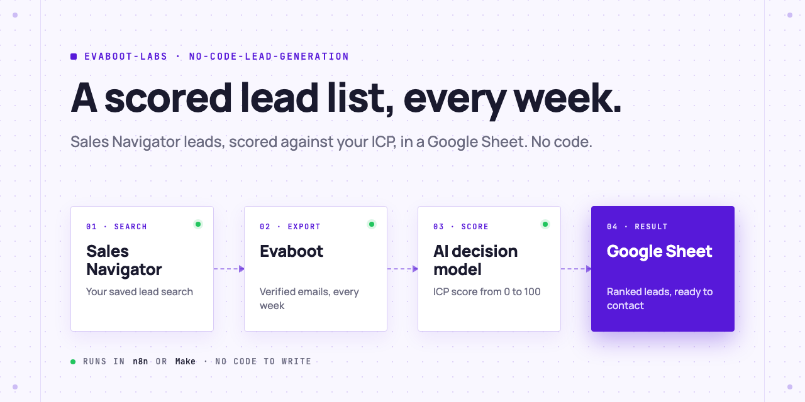
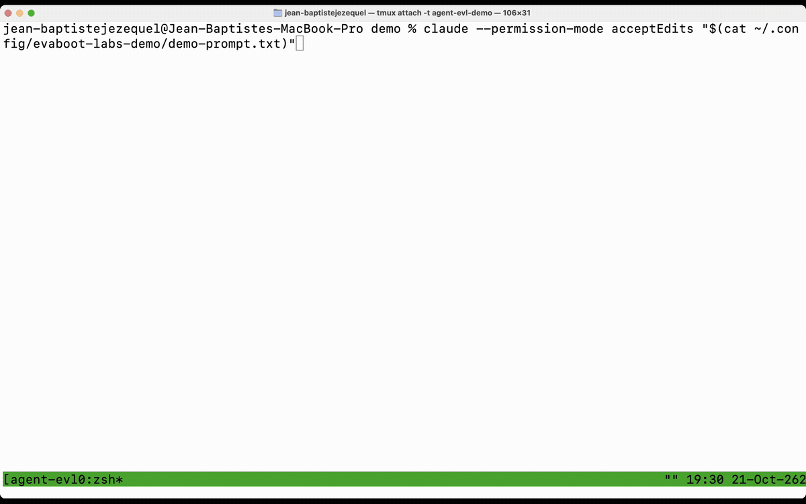
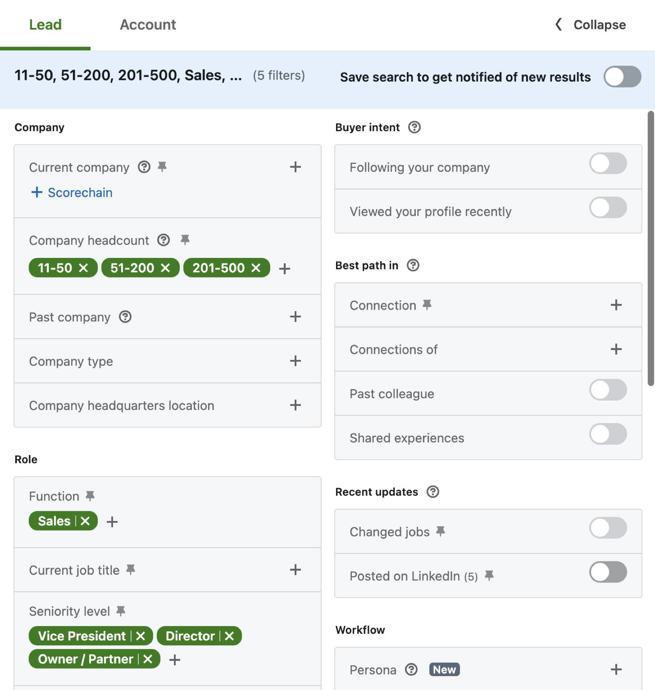
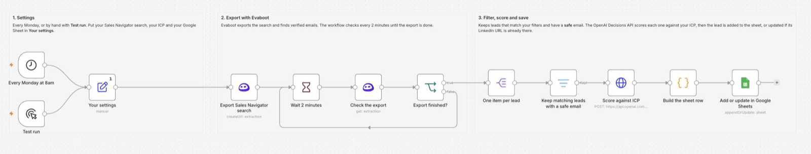
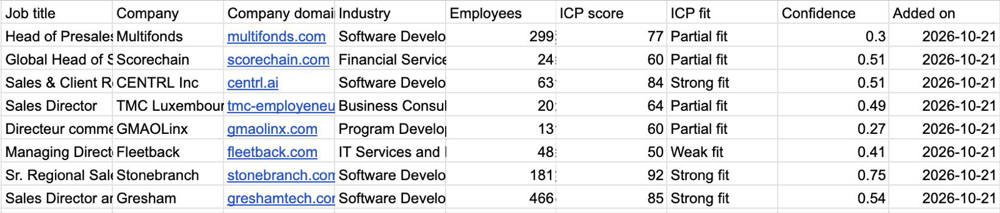
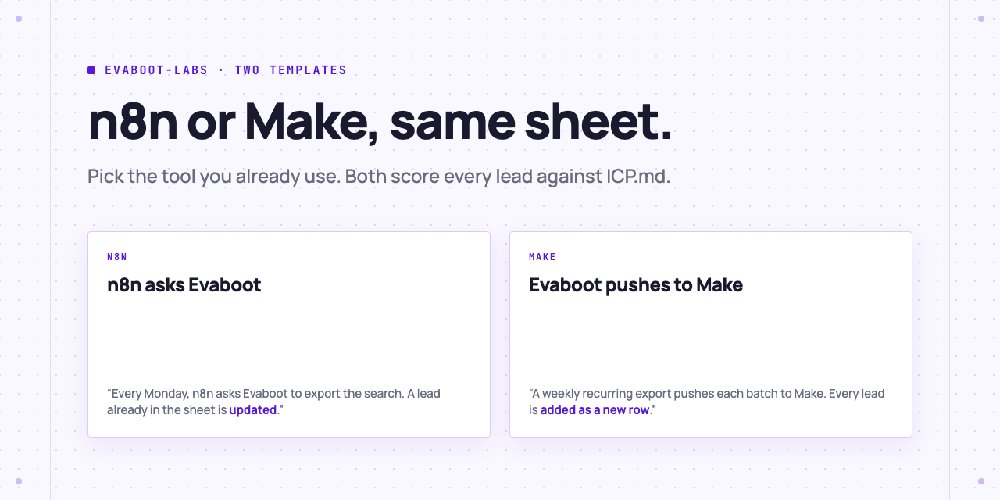

<picture>
  <source media="(prefers-color-scheme: dark)" srcset=".github/assets/banner-dark.png">
  
</picture>

# No-code lead generation

A scored lead list every week, without code. Evaboot exports your Sales Navigator search with verified emails, an AI decision model scores every lead against your ideal customer profile, and the leads land in a Google Sheet.

[](AGENTS.md)
[](LICENSE)
[](https://github.com/evaboot-labs/no-code-lead-generation/generate)

[](.github/assets/demo.mp4)

<sub>The full run, at real speed: [demo.mp4](.github/assets/demo.mp4)</sub>

## Set it up in one prompt

Paste this into Claude Code, Codex or Cursor:

```text
Set up the Evaboot no-code lead list for me. Clone
https://github.com/evaboot-labs/no-code-lead-generation, read AGENTS.md and follow the
build-lead-list skill. Ask me about my ideal customer and whether I use n8n or Make, and
confirm with me before anything that spends Evaboot credits.
```

<details>
<summary>Or install the skill</summary>

Claude Code:

```text
/plugin marketplace add evaboot-labs/no-code-lead-generation
/plugin install no-code-lead-generation@evaboot-labs-no-code-lead-generation
```

Codex, Cursor and other agents:

```bash
npx skills add evaboot-labs/no-code-lead-generation
```

</details>

## How it works

**1. Save a focused search.** Evaboot exports the whole search, so keep it narrow.



**2. Import the workflow.** n8n or Make, with your Evaboot, OpenAI and Google credentials.



**3. Get a scored sheet every week.** Each lead has an ICP score, a fit and a confidence.



## n8n or Make, same sheet

<picture>
  <source media="(prefers-color-scheme: dark)" srcset=".github/assets/templates-dark.png">
  
</picture>

Both score each lead against [`ICP.md`](ICP.md) with the OpenAI Decisions API: [how the score works](docs/scoring.md). Each template also has a Typesafe JEV copy, for teams with a JEV key.

## What you need

- **An Evaboot account** with LinkedIn Sales Navigator connected. [Create one](https://dash.evaboot.com/accounts/signup/?last_click_origin=no-code-lead-generation-repo).
- **An OpenAI API key.** Scoring 1,000 leads costs about 8 cents.
- **A Google Sheet** with the header row from [the skill](skills/build-lead-list/SKILL.md).
- **n8n or Make.**
- **Cost:** one Evaboot credit per lead exported, plus the OpenAI cost.

## Go further

| Page | For |
|---|---|
| [n8n workflow](docs/n8n.md) | Install the Evaboot node, import, fill in your settings |
| [Make scenario](docs/make.md) | Import the blueprint and connect a weekly Evaboot export |
| [How the score works](docs/scoring.md) | The ICP score, fit and confidence columns |

---

Agents: start at [AGENTS.md](AGENTS.md) · Built by [Evaboot](https://evaboot.com) · More workflows at [github.com/evaboot-labs](https://github.com/evaboot-labs) · [MIT license](LICENSE)
